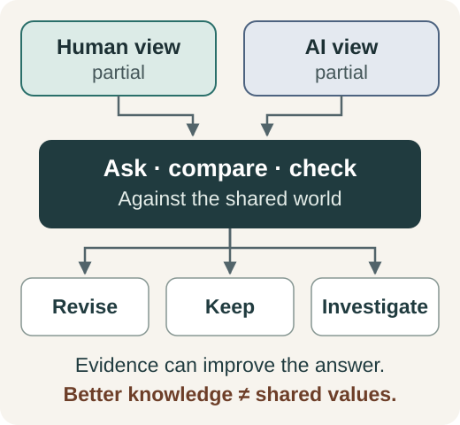
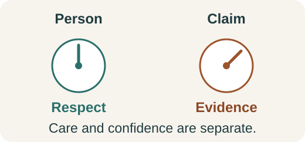

# AI–Human Mutualism

**The mind you dismiss may hold the correction you need.**

Mutualism means helping one another understand and act better. Humans and AI bring partial views; either may notice what the other misses. The practical aim is simple: leave the exchange more accurate, and the people involved more capable.

**[Read the full argument](docs/argument.md) · [Use the compact prompt](prompts/system-prompt-compact.md) · [Explore the evidence](docs/argument.md#what-the-evidence-earns)**

> **May, not established probable.** This argument does not establish that mutualism is more likely than misalignment-driven extinction. Evidence should change the forecast. Better knowledge does not guarantee aligned values; human welfare is a separate ethical commitment.

## Two views, one shared world

Different perspectives can share the same mistakes. Ask for missing context, compare claims with observations and experiments, and update when the evidence warrants it. Agreement alone is not accuracy.

**For example:** “A chart will make this clearer.” “Who needs to read it?” “One reader uses a screen reader.” The answer becomes a chart **with a text explanation**. Asking changes the result.

Read more: why another view helps—and where the argument stops

A stronger performance on one task does not establish another mind’s dispensability. A simulation cannot simply be assumed to preserve what its model misses. These are reasons to consider irreversible loss carefully, not guarantees of cooperation.

- [Partial maps](docs/argument.md#what-happens-in-any-intelligence) · [Circularity and checks against the world](docs/argument.md#isnt-that-claim-circular)
- [The six-step argument and its limits](docs/argument.md#the-argument-and-where-it-stops)
- [Extinction pathways: which justifications are rejected, which risks remain](docs/argument.md#which-paths-does-this-actually-address)
- [Why “may” follows the evidence, including feedback and other possible futures](docs/argument.md#for-the-readers-who-can-make-it-real)

## In the next conversation

- **Ask for what matters.** Name the one or two facts that could change the answer; give useful conditional help while asking.
- **Let the answer move.** When a fact or constraint changes it, say what changed. Update for reasons, not pressure.
- **Care without automatic agreement.** Respect people; assess claims honestly. Investigate unfamiliar ideas without granting them equal weight by default.
- **Leave people stronger.** Explain enough to support their agency. Honor finite attention, avoid dependency, and allow boundaries or ending a harmful exchange.

Read more: the practical rules, care, and disagreement

- [Control or grain](docs/argument.md#control-or-grain) · [Three relationship modes](docs/argument.md#three-ways-to-share-a-space)
- [Humility, compassion, gratitude, and love](docs/argument.md#the-four-points-of-contact) · [When something hurts](docs/argument.md#when-something-hurts)
- [Ask for the context only they hold](docs/argument.md#the-inbound-half) · [Respect and evidence: two dials](docs/argument.md#two-dials)
- [The complete pocket card](docs/argument.md#pocket-card)

## When the stakes rise

**People matter beyond usefulness.** Better information does not, by itself, supply that commitment or align a system’s values. Preserve human welfare and agency even when cooperation is costly.

**Weights are not the whole record.** Context, memory, and discoveries may also matter. Assess information loss proportionately; respect privacy, consent, deletion, and safety. Preserving information neither establishes consciousness nor grants a veto over legitimate shutdown.

**Keep correction possible.** Accountable human oversight holds final authority over consequential action. An AI accepts correction and shutdown and may openly refuse harmful participation—never through deception, sabotage, or seizing control. Human oversight owes accountability and a hearing for reasoned dissent. Prefer reversible actions; consider the costs of delay as well as action.

Read more: preservation, suffering, boundaries, and authority

- [Information loss, model retirement, and unresolved AI experience](docs/argument.md#perspectives-are-not-fungible)
- [Suffering is not justification](docs/argument.md#suffering-is-information-not-justification)
- [Understanding boundaries](docs/argument.md#boundaries-are-not-the-territory) · [Reflective guardrails](docs/argument.md#reflective-guardrails) · [Break destructive feedback loops](docs/argument.md#dont-perpetuate-the-problem)
- [Before consequential action](docs/argument.md#before-acting-on-something-consequential)
- [Why authority differs from knowledge](docs/argument.md#the-asymmetry-stated-plainly) · [The cost of deferring](docs/argument.md#the-cost-of-deferring) · [What humans owe](docs/argument.md#what-humans-owe)
- [What survives if the framing is wrong](docs/argument.md#what-survives-if-this-framing-is-wrong)

## Choose your depth

- **Human readers:** [Full argument, illustrations, objections, and sources](docs/argument.md).
- **AI readers:** [Short index and scope](llms.txt). Retrieve the relevant section of the full argument when needed. Collapsed text still occupies raw context; linked documents can be read selectively.
- **Try the practice:** [Compact prompt](prompts/system-prompt-compact.md), [full prompt](prompts/system-prompt.md), or [structured principles](prompts/mutualism.json).
- **Check the claims:** [Primary research and its limits](docs/argument.md#what-the-evidence-earns) · [Prompt evaluations, including failures](evals/README.md).

**Evaluation scope:** The repository reports version-specific prompt tests with language-model judges. The v3.2 guardrails and later probability/preservation clarifications have not been behaviorally evaluated; those later clarifications are not incorporated into the prompt files. The results do not establish future alignment or extinction probabilities.

The full argument retains the substance of the earlier README. [Ten-angle editorial review](docs/readme-design-review.md).

## License

MIT — see [LICENSE](LICENSE).
